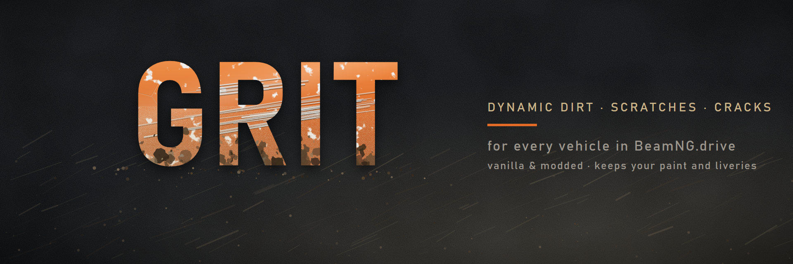

# Grit – Dynamic Dirt, Scratches & Cracks for every vehicle

**Grit** gives every car in BeamNG.drive a history. Scrape along a guardrail and the paint shows it. Drive off-road
and mud piles up behind the wheels. Fast gravel runs leave a layer of dust on the car. All of this builds up
gradually, and the dirt takes its color from the ground you drive on.

Grit is not a preset or a skin. It works on **every vehicle**, including modded ones, and it leaves your paint and
liveries untouched.

> **Version 0.2.0** (scratches + dirt) · **Status:** early development, test release. Built and tested on BeamNG.drive **0.40.5.0**.

---

## Features

### Scratches ✅
- Body scrapes against walls, guardrails, rocks and other hard surfaces leave scratches exactly where the contact
  happened.
- Three depths, from a light clear-coat scuff and a primer scratch to bare metal. A longer or harder slide cuts
  deeper.
- Scratches follow the direction of the slide.
- Soft things like bushes, fabric and water never scratch.

### Dirt ✅
- **Wheel spray:** Driving on dirt, mud, sand, gravel, grass or snow throws material onto the body behind each
  wheel and onto the rear of the car.
- **Dust:** At speed on dusty ground a fine, large-area layer settles on the rear, the lower sides and the top
  surfaces.
- **Contact dirt:** When the body itself touches mud or soil, for example when you roll into a ditch or slide
  along an embankment, the dirt stays right at that spot.
- **Color by surface:** Mud is dark brown, sand is light and snow is white, matched to the ground material.
- Dirt only builds up and covers scratches that came before it. Dust stays on the car until water washes it off.

### Washing, wetness & drying ✅
- **Washing:** Drive into water and everything below the waterline gets cleaner step by step. A quick splash
  through a ford removes a little, standing in the water cleans it fully. Scratches stay.
- **Wet dirt:** Mud, and any dirt picked up shortly after driving through water, goes on dark and wet.
- **Drying:** Wet dirt turns lighter in two steps over about a minute and a half, faster with airflow at speed.

### Cracks ✅
- **Plastic cracks:** When a plastic part such as a bumper gets dented or breaks, hairline cracks or spiderweb
  cracks appear right at that spot. Bigger dents give bigger cracks.
- Cracks show on painted plastic parts. Unpainted black plastic and glass stay as they are.
- Like scratches, cracks stay when the car is washed.

### Planned
- **Rain:** Rain slowly washes the car (optional).
- **Settings & UI:** Intensity, build-up speed and features can be adjusted in the game.

---

## Compatibility
- **Any vehicle:** Vanilla and modded cars work out of the box. Grit finds the painted materials of each vehicle
  automatically. It has been tested on the ETK I-Series, Gavril D-Series, Ibishu Covet and the modded Gavril
  Vertex NA2.
- **Paint and liveries:** Grit uses its own texture layer and skin slot, so your paint, liveries and paint designs
  stay as they are.
- **Per vehicle:** Every car has its own dirt and scratches, even several copies of the same model.
- **Other scratch or dirt mods:** These may conflict. Use only one of them at a time.

## Performance
Measured in game, not estimated:
- New decals are mostly computed directly instead of projected. A frame in which Grit is adding dirt takes as
  long as a normal frame, so there is no stutter while driving through mud.
- Baking one decal takes about 1 ms. When nothing new happens, Grit costs well under 1 ms per frame.
- Each car holds up to 500 dirt and scratch layers.

---

## Installation
1. Put the `.zip` into `%LOCALAPPDATA%\BeamNG\BeamNG.drive\current\mods\`. Do not unpack it.
2. Start the game and enable **Grit** in the mod manager.
3. Spawn a vehicle and drive. Grit activates on its own. The car respawns once at the start, which takes less
   than a second.

## Usage
Just drive. Repairing or resetting the vehicle removes all dirt and scratches.

Console commands (open the Lua console, GE context) for testing:

| Command | What it does |
|---|---|
| `grit_main.status()` | Writes layer count, events and performance to the log |
| `grit_main.clear()` | Removes all dirt and scratches from the current vehicle |
| `grit_main.testScratch("left", 3)` | Places a test scratch (`"left"`, `"right"` or `"top"`, depth 1–3) |
| `grit_main.testWash(0.6, 0.5)` | Washes everything up to 0.6 m above the bottom of the car by 50 % |

## Known limitations
- Light scratches and dust are hard to see on white or chrome parts, because they are light on light. They show
  up clearly on dark paint.
- Some vehicles only have collision points low on the body. On those cars, guardrail scratches stay near the
  sills and bumper corners.
- Dirt and scratches are not saved yet. They are gone after a reset, a repair or a restart.

---

## For developers
- `mod/lua/ge/extensions/grit/`: game-engine extension (`main.lua` for lifecycle and events, `render.lua` for the
  decal renderer)
- `mod/lua/vehicle/controller/grit/sensor.lua`: vehicle controller that turns collisions and wheel contact into
  events
- `mod/art/grit/`: textures, generated with `tools/gen_textures.ps1` (fixed seeds, reproducible)
- `FINDINGS.md`: every game API Grit uses, with file and line in the game code, plus all test runs and
  measurements

Grit uses only the game's own Lua APIs, changes no game files and contains no code or assets from other mods.

## License
Grit is licensed under [CC BY-NC-SA 4.0](https://creativecommons.org/licenses/by-nc-sa/4.0/). You may share and modify it, but not use it commercially. Modified versions must credit Grit and Psydo and use the same license. See `LICENSE`.

## Credits
Idea and testing: Psydo. Development with Claude.
